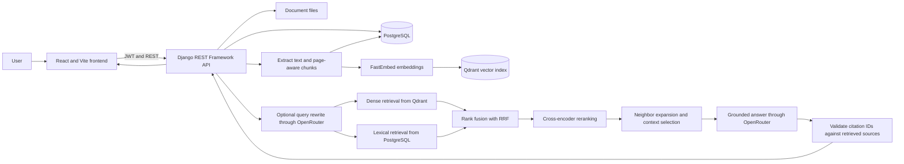

# Knowledge RAG Engine

A document-grounded question-answering platform built with Django REST Framework,
PostgreSQL, Qdrant, FastEmbed, and OpenRouter. Upload PDF, TXT, or Markdown
documents, retrieve relevant passages, and ask questions with source citations.

The project is designed to make retrieval stages measurable and replaceable,
rather than treating RAG as a single LLM call. It is a portfolio and learning
project; production deployment and benchmark results are not claimed here.

## Features

- JWT-authenticated document management and per-user document access
- PDF, TXT, and Markdown ingestion with page-aware chunks
- Dense vector search and PostgreSQL full-text search
- Reciprocal Rank Fusion (RRF), cross-encoder reranking, and optional query rewriting
- Neighboring-chunk expansion and bounded context construction
- Answers grounded in retrieved passages, with validated, interactive citations
- Document-scoped chat history
- Retrieval and answer evaluation commands with JSON reports

## Architecture



### Request and ingestion flow

1. The API validates the upload, extracts PDF pages or text, and creates
   overlapping chunks while retaining source-page and offset metadata.
2. FastEmbed converts chunks into vectors. Qdrant stores those vectors alongside
   payload fields used to filter and display results. PostgreSQL remains the
   source of truth for users, documents, pages, chunks, and conversations.
3. For a question, the optional query-understanding step can generate a
   rewritten query and up to three variants. Dense and lexical retrieval run for
   the resulting queries.
4. RRF combines ranked result lists; a cross-encoder reranks candidates.
   Adjacent chunks are added to preserve context, then the context optimizer
   bounds and orders the passages sent to the answer model.
5. The answer model receives source-labelled passages. Citation markers in its
   response are checked against the available sources before being returned.

## Engineering decisions

| Decision | Why |
| --- | --- |
| **Qdrant for vectors** | Purpose-built vector indexing and similarity search keep embedding retrieval separate from transactional application data. Payload metadata supports document-level filtering and source attribution. |
| **PostgreSQL for application data and lexical search** | Relational constraints fit ownership, documents, pages, chunks, and chat history. PostgreSQL full-text search also provides a lexical retrieval path without introducing another search service. |
| **Hybrid retrieval** | Semantic search can find paraphrases while lexical search helps with exact terms, identifiers, and rare names. Combining them reduces dependence on either matching style alone. |
| **RRF for rank fusion** | Dense similarity and lexical relevance scores are on different scales. RRF combines their ranks, avoiding score normalization and giving credit to results that appear near the top of multiple lists. |
| **Cross-encoder reranking** | Initial retrieval is optimized for candidate recall. A cross-encoder scores each query-candidate pair jointly to improve ordering before the limited context window is spent. |
| **Query rewriting and expansion** | A precise rewrite and a small number of alternate searches can bridge vocabulary differences between a question and a document. This stage is configurable; retrieval falls back to the original query if rewriting is unavailable. |
| **Neighboring chunks** | A relevant chunk can omit a definition, qualification, or continuation located next to it. Neighbor expansion adds local context while the context optimizer limits what reaches the model. |
| **OpenRouter for generation and rewriting** | The OpenAI-compatible API provides one integration point with a configurable model. The configured model and API key are supplied at runtime, not committed to the repository. |
| **FastEmbed for embeddings** | Embeddings are generated in the application using a configurable local FastEmbed model, separate from the hosted answer-generation provider. The default model produces 384-dimensional vectors. |

## Evaluation

The repository includes an evaluation harness and a golden question dataset at
[`documents/evaluation/questions.json`](documents/evaluation/questions.json).
The harness scores retrieval using Recall@5, Precision@5, MRR, Hit@5, and NDCG@5.
The full run also evaluates answer correctness, relevance, faithfulness, citation
accuracy, latency, token use, and reported OpenRouter cost.

The configured comparison stages are:

| Label | Strategy |
| --- | --- |
| A | Dense retrieval |
| B | Hybrid retrieval |
| C | Hybrid retrieval + reranker |
| D | Query rewriting + reranker |
| E | Full Phase 10 pipeline, including the additional context/retrieval stages |

**Benchmark results: not published yet.** No evaluation report is currently
checked into the repository, so numeric scores are intentionally omitted. Do
not treat illustrative percentages from plans or examples as measured results.
Run the evaluation against the matching indexed dataset before publishing
metrics. The checked-in questions reference specific document and chunk IDs;
the corresponding document must be indexed in the configured database.

Retrieval-only comparison (A-C; does not call the answer model or judge):

```bash
python manage.py evaluate_rag --retrieval-only --output rag-retrieval-report.json
```

Full comparison (A-E; makes OpenRouter generation, rewriting, and judge calls,
which may incur provider cost):

```bash
python manage.py evaluate_rag --output rag-full-report.json
```

For a different dataset, pass `--dataset path/to/questions.json`. Use
`--document-id ID` only when the expected chunk IDs in that dataset belong to
the specified document. Keep generated reports out of version control unless
they are reproducible and intentionally being published; record the dataset,
configuration, and model versions alongside any reported scores.

## Local development

### Prerequisites

- Python 3.12
- Node.js and npm
- Docker Compose
- An OpenRouter API key and configured model for question answering

### Start data services

From the repository root:

```bash
docker compose up -d postgres qdrant
```

The Compose file exposes PostgreSQL on port `5435` and Qdrant on port `6335`.
Configure the Django environment to use those host ports. Create a local `.env`
file (never commit credentials) with the database settings and these service
settings:

```dotenv
DEBUG=True
POSTGRES_DB=rag_db
POSTGRES_USER=rag_user
POSTGRES_PASSWORD=rag_password
POSTGRES_HOST=localhost
POSTGRES_PORT=5435
QDRANT_URL=http://localhost:6335
OPENROUTER_API_KEY=replace-with-your-key
OPENROUTER_MODEL=replace-with-a-supported-model
```

The PostgreSQL values above match the local Compose defaults and are for
development only. Use strong credentials and managed services outside local
development. Other settings such as `EMBEDDING_MODEL`, `RERANKER_MODEL`,
`RAG_TOP_K`, and `ENABLE_QUERY_REWRITING` can be overridden through environment
variables; defaults are defined in `config/settings.py`.

### Start the backend

```bash
python -m venv venv
source venv/bin/activate
pip install -r requirements.txt
python manage.py migrate
python manage.py runserver
```

The API runs at `http://localhost:8000`. Interactive API documentation is
available at `http://localhost:8000/api/docs/`.

### Start the frontend

In another terminal:

```bash
cd frontend
npm ci
npm run dev
```

Vite serves the frontend and proxies `/api` requests to the local Django server.

### Tests and lint

From the repository root:

```bash
python manage.py test
```

For frontend linting:

```bash
cd frontend
npm run lint
```

## Repository map

- `config/` — Django settings, URL routing, and ASGI/WSGI entry points
- `documents/` — document lifecycle, ingestion, retrieval, RAG, citations, and evaluation
- `users/` — authentication endpoints
- `core/` — health and service endpoints
- `frontend/` — React application
- `docker-compose.yml` — local PostgreSQL and Qdrant services

## Limitations and next steps

- Evaluation scores depend on the dataset, indexed corpus, thresholds, and model
  versions; benchmark claims should include those details.
- Full answer evaluation uses an LLM judge and is not a deterministic,
  cost-free test.
- The included Compose setup is for local development, not production
  deployment.
- Review the operational configuration (secrets, allowed hosts, storage,
  observability, and service availability) before deploying publicly.
